# Ubuntu Server Security Monitoring & Bash Automation Lab

**Author:** Anastasia Stout\
**Program:** MSSA – Server & Cloud Administration

- Deployed a Generation 2 Ubuntu Server 24.04 virtual machine (VM) on a Windows 11 Hyper-V host; administered it over remote SecureShell (SSH) from PowerShell, configuring static IPv4 with Netplan, a default-deny Uncomplicated FireWall (UFW) with SSH restricted to the management host, and a backup sudo administrator account.
- Investigated simulated failed SSH logins with journalctl and grep, preserved log evidence, and mapped findings to MITRE ATT&CK (Credential Access, T1110), distinguishing credential-guessing indicators from a confirmed attack.
- Wrote a Bash script with conditional logic and exit-status error handling that generates timestamped reports of uptime, disk usage, and 24-hour SSH authentication events; tested the failure path before finalizing.

> **AI Acknowledgment:** ChatGPT was used as a resource for learning exercises and troubleshooting. All configurations, testing, analysis, and documentation were performed and verified by the author.

---

## Summary of Skills Demonstrated

| Area | What I did |
| --- | --- |
| **Virtualization** | Assessed host capacity, enabled Hyper-V, and built a Generation 2 Ubuntu Server 24.04 LTS VM sized to the host |
| **Linux administration** | Installed and configured Ubuntu Server, managed users, groups, file permissions, and `systemd` services |
| **Network configuration** | Configured static IPv4 addressing on host and guest with Netplan, using safe change-and-rollback practices |
| **Hardening** | Applied UFW with a default-deny policy and least-privilege SSH access; created a backup administrator account |
| **Security monitoring** | Used `journalctl` and `grep` to detect, filter, and correlate failed SSH authentication events |
| **Incident analysis** | Wrote an investigative report with objective, method, evidence, findings, and conclusion, mapped to MITRE ATT&CK |
| **Bash scripting** | Built an automated report generator using variables, conditional logic, command grouping, and exit-status handling |
| **Testing & validation** | Deliberately broke the script to prove its error handling works, then restored and retested it |
| **Documentation** | Recorded decisions, reasoning, and evidence throughout |

---

## Scenario

> *You are a junior systems administrator supporting a small organization. Your supervisor has asked you to deploy an Ubuntu server, establish basic security settings, and develop a Bash script that produces a report on system health and potentially suspicious activity.*

**Deliverables:** a functioning Ubuntu VM, evidence of security log monitoring, and a working Bash monitoring script.

---

## Project Outline

- [Part 1 – Build and Harden the Ubuntu Server VM](#part-1--build-and-harden-the-ubuntu-server-vm)
  - 1.1 Create the VM in Hyper-V Manager
  - 1.2 Install the OS, create two administrator accounts, connect over SSH
  - 1.3 Practice navigation, file permissions, users, and services
  - 1.4 Enable and verify UFW firewall rules
  - 1.5 Take a VM checkpoint
- [Part 2 – Security Monitoring with Native Linux Tools](#part-2--security-monitoring-with-native-linux-tools)
  - 2.1–2.2 Establish a baseline and simulate invalid logins
  - 2.3 Analyze SSH authentication events
  - 2.4 Collect and verify log evidence
  - 2.5 Record the investigative summary
- [Part 3 – Automate Monitoring in Bash](#part-3--automate-monitoring-in-bash)
  - 3.1 Develop the security monitoring script
  - 3.2 Test the script and produce a timestamped report

---

## Virtualization Readiness Assessment

Before building anything, I confirmed the host could support the VM without being starved of resources: a Windows 11 Pro host with a 6-core AMD Ryzen 5, 14 of 32 GB RAM free, and 370 GB of free disk, against a VM needing 2 vCPUs, 4 GB RAM, and a 30 GB virtual disk. I enabled CPU virtualization in UEFI, enabled the Hyper-V feature with PowerShell, and confirmed `State: Enabled` after a restart.

View comparison table

| Component | My system | VM requirement |
| --- | --- | --- |
| Operating system | Windows 11 Pro | Ubuntu Server 24.04 LTS (x64) |
| Processor | AMD Ryzen 5, 6 cores / 12 logical | 2 virtual processors |
| Available RAM | 14 of 32 GB | 4 GB (Dynamic Memory disabled) |
| Hypervisor | Hyper-V | Virtualization enabled |
| Network | Hyper-V internal switch | Host-to-guest communication |
| Available disk | 370 GB | 30 GB dynamically expanding VHDX |

---

## Part 1 – Build and Harden the Ubuntu Server VM

### 1.1 Create the VM in Hyper-V Manager

| Setting | Choice |
| --- | --- |
| VM name | `UBUNTU-SEC01` |
| Generation | Generation 2 (UEFI) |
| Memory | 4 GB, no Dynamic Memory |
| Networking | Internal switch, static IP in the host subnet |
| Storage | 30 GB dynamically expanding VHDX |
| Install media | bootable Ubuntu ISO |

**Design decisions**

- **Fixed memory instead of Dynamic Memory.** The host has plenty of RAM, and fixed allocation makes resource usage predictable and easier to troubleshoot.
- **Internal switch with no internet access.** The project only needs host-to-guest communication, so the VM is isolated from external networks. I assigned static addresses within `192.168.100.0/24` on both the Windows host (`192.168.100.1`) and the VM (`192.168.100.10`) to support SSH administration and authentication monitoring.
- **Dynamically expanding VHDX.** This conserves host disk space rather than immediately consuming the full 30 GB.

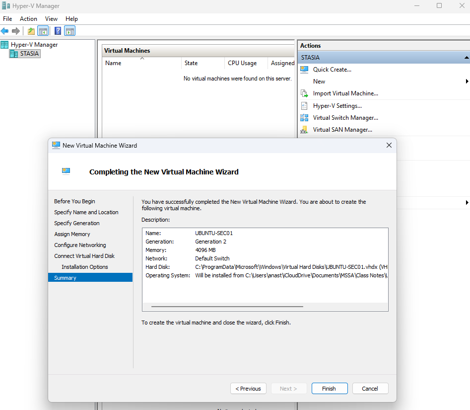\
*Hyper-V virtual machine configuration wizard*

### 1.2 Install the OS, create two administrator accounts, connect over SSH

I installed Ubuntu Server with OpenSSH, configured the primary administrator, and created a backup sudo account after installation.

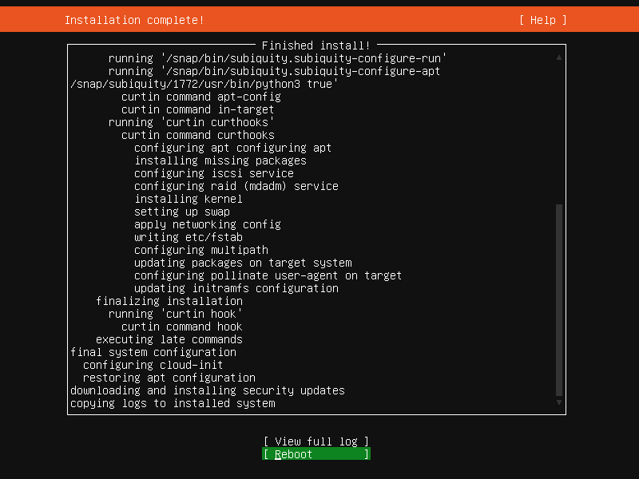\
*Ubuntu Server installation complete*

| Account | Purpose |
| --- | --- |
| `sysadmin` | Everyday administration and Bash development |
| `backupadmin` | Emergency administrative access if the primary account is misconfigured or disabled |

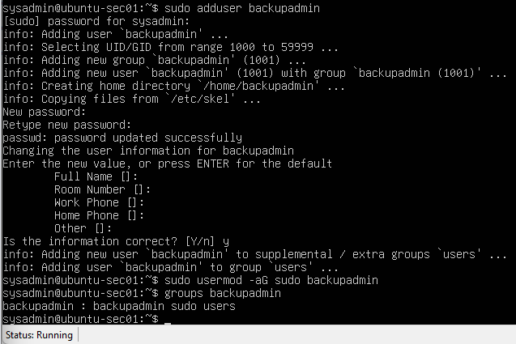\
*Backup administrator account created and verified as a member of the `sudo` group*

**Design decisions**

- **A second administrator account** protects against being locked out of the server if the primary account is misconfigured or disabled.
- **SSH password authentication was purposely left enabled.** It was needed to generate and investigate both successful and failed password authentication events in Part 2. In a production environment, I would disable password authentication in favor of key-based authentication.

- **Static IP configuration with Netplan.** Before editing, I made a backup copy of the configuration file, then disabled DHCP and set a static address. I validated the YAML with `netplan generate` and applied it with `netplan try`. `netplan try` automatically reverts if the change is not confirmed, which protects against losing remote access due to a bad network configuration.

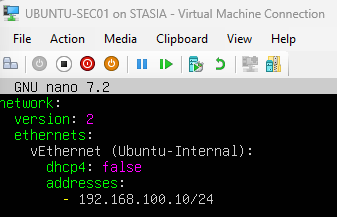\
*Static IPv4 configuration using Netplan*

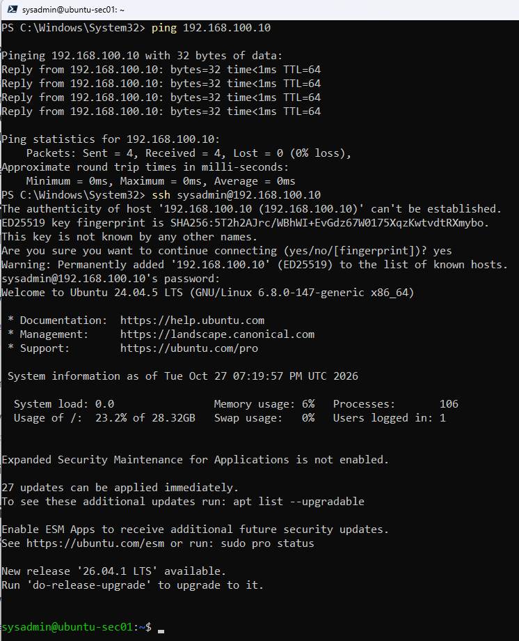\
*Verified host-to-guest connectivity with ICMP and established an SSH session from the Windows host*

### 1.3 Practice navigation, file permissions, users, and services

Inspected ownership and permissions in the sysadmin home directory, confirmed the Bash history file was restricted to its owner (600), verified both administrator accounts belong to the `sudo` group, and reviewed running services with `systemctl` to set a baseline for future monitoring.

The review showed **SSH as active but not enabled**, which taught me to check a service's boot-time state separately from whether it is currently running.

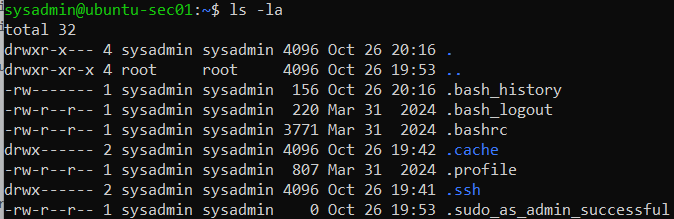\
*Home directory metadata: `.ssh` and `.bash_history` are accessible by the owner only*

### 1.4 Enable and verify UFW rules

- **Default-deny approach:** all incoming traffic is blocked and outgoing traffic is allowed.
- **Principle of least privilege:** SSH (port 22/TCP) is permitted only from the Windows management host (`192.168.100.1`), not from any address.
- **Verification:** confirmed the active policy and rule with `ufw status verbose`.

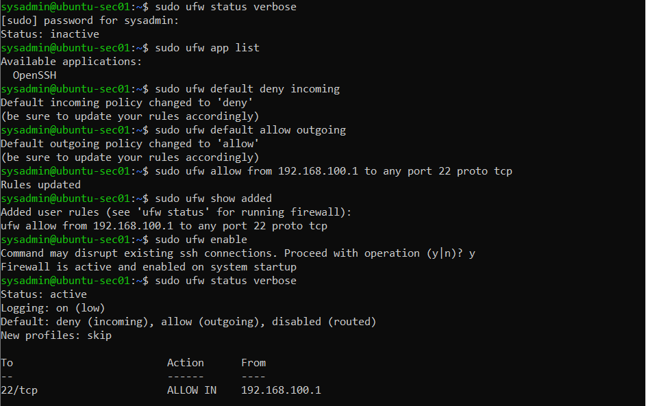\
*UFW default-deny policy with SSH restricted to the management host*

### 1.5 Take a VM checkpoint

After the initial OS and firewall configuration, I created a Hyper-V checkpoint (`Initial OS & UFW configuration`) from PowerShell and verified it. This gives me a known-good recovery point to roll back to if later testing goes wrong.

---

## Part 2 – Security Monitoring with Native Linux Tools

### 2.1–2.2 Establish a baseline and simulate invalid logins

I first reviewed the 20 most recent SSH journal entries with `journalctl`. The baseline contained no failed attempts, so anything that appeared afterward could be attributed to my testing. 

From the Windows host, I then made three SSH attempts using nonexistent usernames and incorrect passwords: `administrator`, `oracle`, and `postgres`, which are common default or high-value account names that attackers often try.

### 2.3 Analyze SSH authentication events

I searched the last 15 minutes of the SSH service journal and filtered for `invalid user` and `failed password` events.

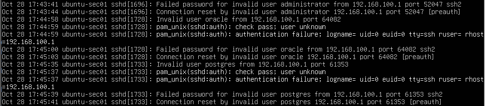\
*SSH authentication log analysis – multiple invalid usernames*

### 2.4 Collect and verify log evidence

I exported the SSH journal for the past 30 minutes to a text file, then filtered the saved file to preserve evidence for documentation and later review.

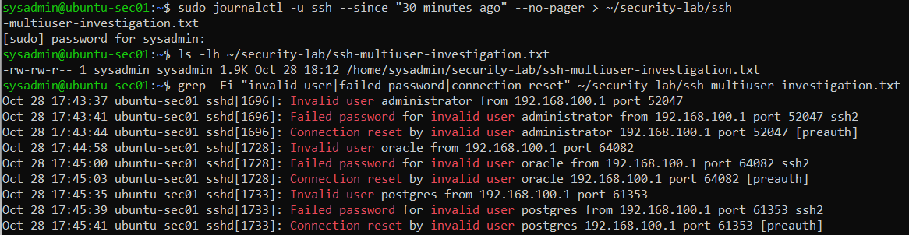\
*Exported SSH log evidence filtered for invalid users, failed passwords, and connection resets*

**SSH Authentication Attempt Log Findings**

- All three usernames (`administrator`, `oracle`, `postgres`) appear in the log.
- All attempts came from `192.168.100.1`, using different ephemeral source ports.
- Every attempt was unsuccessful.

### 2.5 Investigative summary

**SSH Authentication Investigation Report**

| | |
| --- | --- |
| **Objective** | Investigate potentially suspicious SSH authentication activity by correlating failed login attempts across multiple usernames. |
| **Method** | Generated controlled SSH authentication attempts against three invalid usernames from the Windows lab host. |
| **Evidence** | SSH authentication events exported with `journalctl` to `ssh-multiuser-investigation.txt`. |
| **Findings** | Unsuccessful authentication attempts against all three usernames, from one IP address (`192.168.100.1`), using different ephemeral source ports. |
| **MITRE ATT&CK analysis** | Evaluated against **Credential Access (TA0006)** and **Brute Force (T1110)**. Failed attempts across multiple usernames can be associated with credential-guessing activity, but the limited evidence does not establish a brute-force or password-spraying attack. |
| **Conclusion** | The events were authorized test activity. In a production environment, similar unexpected activity would warrant further investigation into its frequency, source, and potential malicious intent. |

**Analyst Note:** Three failed attempts from one source are consistent with credential guessing, but they are not enough to call it an attack. Matching what the evidence supports to a framework such as MITRE ATT&CK, without over- or under-calling it, is a core part of SOC analysis.

---

## Part 3 – Automate Monitoring in Bash

I developed `security-monitor.sh` over a remote SSH session to automate system health checks and SSH authentication monitoring. The script is included in this repository: [`security-monitor.sh`](security-monitor.sh).

### 3.1 Develop the Bash security monitoring script

**Report contents**

- Hostname, UTC timestamp, and system uptime
- Disk utilization for the root filesystem
- SSH authentication events from the past 24 hours, filtered for:
  - `Accepted password` – successful authentication
  - `Failed password` – unsuccessful password authentication
  - `Invalid user` – attempts using a nonexistent username

**Design decisions**

- **Command grouping and redirection:** The report sections are grouped with `{ }` and redirected with `>` so everything is written to a single report file.
- **Unique, timestamped filenames:** Each report uses a UTC timestamp, so runs never overwrite each other and reports sort chronologically. I used hyphens in the time portion so the filenames are compatible with Windows.
- **Distinguishing "no results" from "failure:"** An empty result and a failed query mean very different things for a monitoring tool. If the report says *"no matching events"* because the query silently failed, that is a false sense of security. I used nested conditionals to tell them apart:
  - The **outer `if`** checks the exit status of the `journalctl` query to detect retrieval failures.
  - The **inner `if`** uses a `-z` string test to determine whether a successful query contained any matching events.
- **Exit-status reporting:** A `report_status` variable starts at `0` and is set to `1` if the journal query fails. The script ends with `exit "$report_status"`, so other scripts or schedulers can tell a successful run from a failed one.

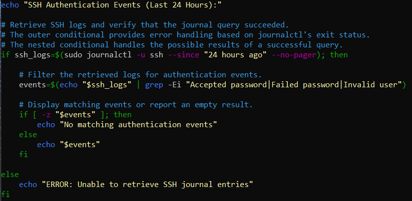\
*SSH authentication monitoring and error handling*

**Validating the error handling:** I simulated a journal retrieval failure by temporarily substituting an invalid command, then confirmed the script displayed a warning and returned exit status `1`. I then restored the original command and re-ran the script to confirm normal behavior. Testing the failure path, not only the success path, is how I verified the script behaves correctly when something goes wrong.

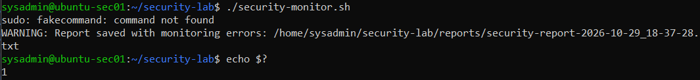\
*Error handling validation – simulated journal query failure*

### 3.2 Test the script and produce a timestamped report

I ran `security-monitor.sh` and confirmed the generated report contained:

- Server hostname and UTC timestamp
- System uptime
- Disk utilization
- SSH authentication events from the past 24 hours

The script also saves the report to a dedicated directory and prints the file path to the terminal.

---

## Conclusion

This project simulated the responsibilities of a junior systems administrator: deploying a server, securing it, monitoring it, and automating that monitoring. Beyond completing the individual tasks, I focused on the reasoning behind each decision: 
- resourcing the VM based on the host's capacity
- using a default-deny firewall with least-privilege SSH access
- keeping a backup administrator account and recovery checkpoints
- applying safe network changes with `netplan try`
- separating failed queries from empty results in the monitoring script

The investigation work reinforced skills that apply directly to SOC analyst and server administrator roles: establishing a baseline, preserving evidence, correlating events by source and username, mapping findings to MITRE ATT&CK, and stating conclusions that match the evidence. The Bash script then turned those manual steps into a repeatable, testable process, and testing its failure path gave me confidence it can be trusted to report problems honestly.

---

## Repository Contents

| File | Description |
| --- | --- |
| `README.md` | Project overview and documentation |
| `security-monitor.sh` | Bash script that generates the system health and SSH authentication report |
| `images/` | Screenshots referenced in this README |

---

## Sources and References

- [Ubuntu Server Documentation](https://ubuntu.com/server/docs/)
- [MITRE ATT&CK Framework – Credential Access (TA0006)](https://attack.mitre.org/tactics/TA0006/)
- [Bash Tutorial (W3Schools)](https://www.w3schools.com/bash/index.php)

